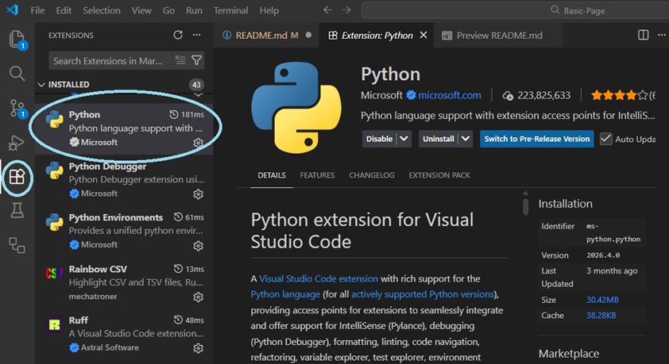
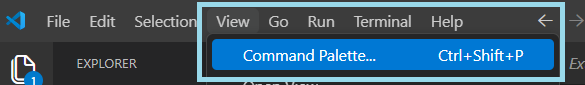
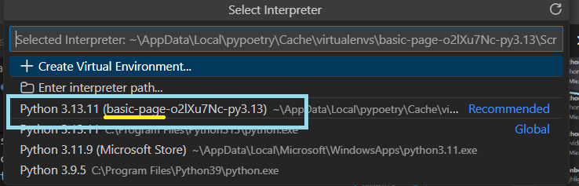
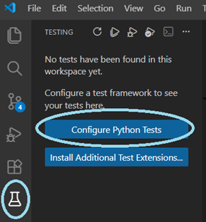
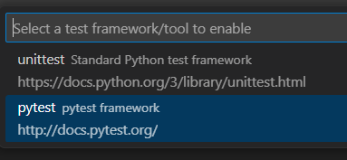
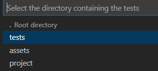
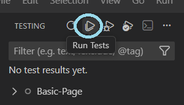

# Mobile-first Website Project

## Learning Target: 
Students will develop a multi-page, mobile-first website with structured HTML and formatted content using CSS that is designed first for a hand-held width, and then adjusted through `@media` breakpoints to look more appropriate for wider widths.

---------
[top](#mobile-first-website-project) | [project] [learning target](#learning-target) | [instructions](#instructions) | [project requirements](#project-requirements) | [grading](#grading)

## Instructions:
Once you have accepted the assignment and have a copy of your repo...

### Project Setup

<b><i>* Testing Setup</i></b>

***NOTE**: this step is only necessary if you want to check to make sure you've met all your `HTML` and `CSS` requirements.*

* Open the Software Center and make sure the following apps are installed in the following order...
    - Python
    - Python Poetry
    - Python pip-system-certs
* Open your project in VSCode.
* Make sure that the Python Extension from Microsoft is installed
    
* Open the terminal (Terminal > New Terminal)
* Type: `poetry env activate`
* Type: `poetry update`
* Open the Command Palette
    - Click on the View Menu then select Command Palette
    
    *OR*
    - Type `CTRL` + `Shift` + `P`
* In the Command Palette...
    - Type: "Python: Select Interpreter"
    - Select the one that states basic-page and shows "poetry" on the side.
    

<b><i>* Testing your project using pytest</i></b>

***NOTE**: this too is only necessary to test your project to see if you meet all `HTML` and `CSS` coding requirements.

1. Click the Test Icon (a flask) and choose "Configure Python Tests"

    
2. Select the "pytest" test option

    
3. Select the tests folder

    
4. Click the run test icon

    
5. NOTE: you will fail tests until you begin coding and meeting requirements.

### Working on Your Project 

<b>Adding your Web Content</b>

1. Open your project in VSCode.
2. Get your files from the `Multipage Website project` and paste them in the project folder
3. Remove any `CSS` from your files. You will do the `CSS` as a mobile-first design.
4. Keep at least one main `CSS` stylesheet

<b>Styling Your Page</b>

1. Make sure all pages link to your main `CSS` stylesheet.
2. Begin moving in `CSS` code from the multi-page website, but do so carefully
3. Add only the styles that will be common no matter how large the viewport will be (such as typography, colors)
4. When testing, be sure to start with a browser that is as narrow as you can get it.
5. Style it like you are styling for a small phone in portrait view.
6. Add a vertical navbar, and eventually, you will add a button to make it a pop-out menu.
7. Once you like the design for mobile, stretch the screen until you think you can add one or more of the following:
    * a horizontal navbar
    * a two-column layout
8. Figure out the screen widthe and add an `@media screen and (min-widght: 600px) { }` or something like that.
9. Continue expanding and adding any other features for a good looking tablet in landscape mode, and then desktop mode.

### Tracking Your Project History

<b>Using Git</b>

* As you work on your page, be sure to commit and push your changes using the following commands:
    - `git add *`
    - `git commit -m "concise explanation of what you did"`
    - `git push origin main`
* When you push a commit, the **Autograding Tests** GitHub Actions workflow runs the pytest suite.
* The workflow shows a green check when all tests pass. Its run summary lists passed, failed, and skipped tests per test file, includes details for failing tests, and gives a final score out of 4: 4/4 for all tests passing; 3/4 when all tests in files with `proficiency` in their names pass; 2/4 when at least half of all tests pass; otherwise 1/4.
* To turn in your assignment, take a screen capture of the final product as seen on a browser and turn that in.
    - Your teacher can see if you passed all tests
    - You will then receive a grade based on the scoring categories (see [scoring categories](#scoring-categories))

---------
[top](#basic-page-project) | [learning target](#learning-target) | [instructions](#instructions) | [project requirements](#project-requirements) | [grading](#grading)

